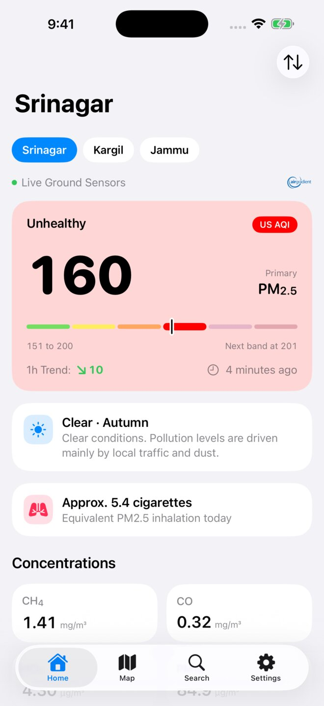
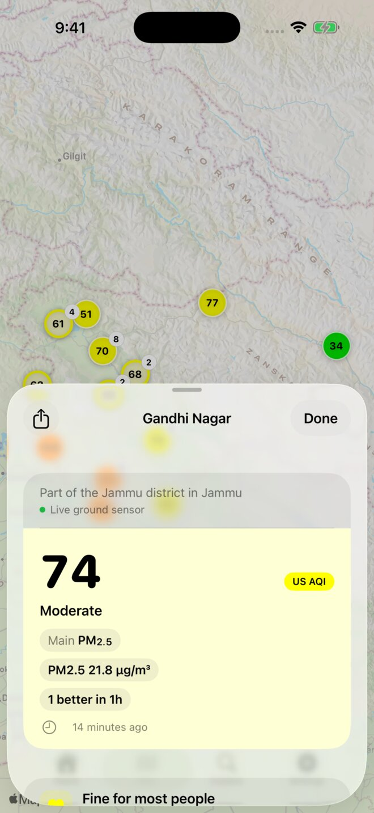
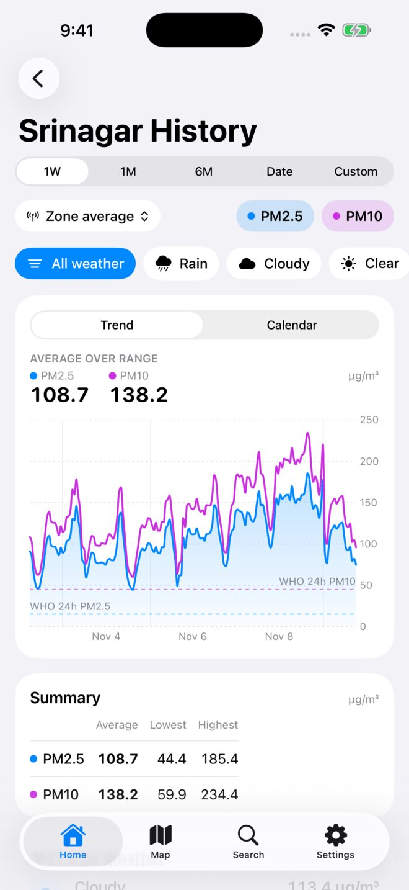
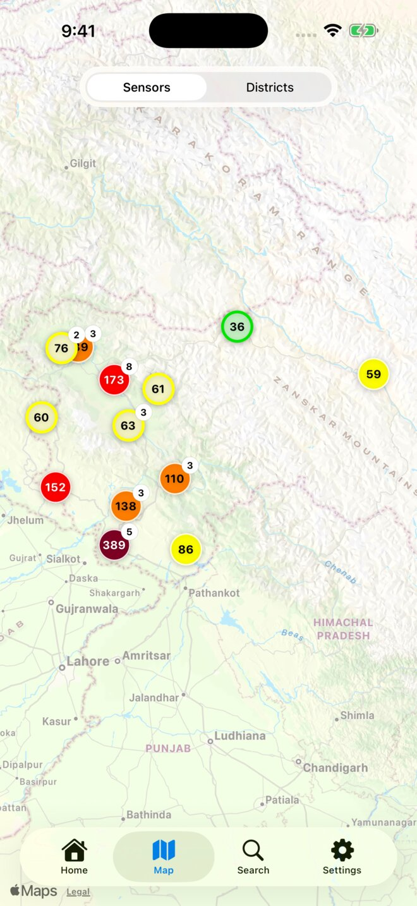

# Breathe (iOS)

> _"Breathe, breathe in the air. Don't be afraid to care."_ - **Pink Floyd**, _The Dark Side of the Moon_

<p align="center">
  
</p>

<p align="center">
  
  
  
  
</p>

> **Note:** This repository is specifically for the **iOS** version of Breathe. If you are looking for the original Android version, please visit the [Breathe (Android) repository](https://github.com/breathe-OSS/breathe).

**Breathe** is a native iOS app for real-time Air Quality Index (AQI) levels across J&K & Ladakh. It is built with **Swift** and **SwiftUI**, shows the US AQI (EPA breakpoints) by default and can switch to India's National Air Quality Index (NAQI).

- Check the [**breathe api**](https://github.com/breathe-OSS/api?tab=readme-ov-file#how-the-aqi-is-calculated) repo to know how the AQI is calculated.

## Download

[](https://apps.apple.com/app/id6761560112)

---

## Features

- **Native iOS design** with cards, Dynamic Type, and light and dark mode
- **US AQI and Indian NAQI**, switchable in Settings
- **Segmented AQI gauge** with a guide to what every band means
- **Live ground sensors**, with every sensor in a zone listed, offline ones included
- **24 hour trend and hourly charts** you can drag across to read any hour
- **Extended history** with weather filters, WHO guideline lines and a calendar view
- **Map** of every zone and sensor, grouped when zoomed out
- **Swipe between pinned places**, with context menus and haptics
- **Cigarette equivalence**
- **Home screen widgets**
- **Follows Reduce Motion**

## Tech Stack

- **Language:** Swift
- **UI Framework:** SwiftUI, Swift Charts and MapKit
- **Architecture:** MVVM (Model-View-ViewModel)
- **Networking:** URLSession
- **Concurrency:** Swift Concurrency (async/await)

## Structure

```
Breathe/
├── Breathe/App/
│   └── BreatheApp.swift        # Application entry point
├── Models/
│   └── Models.swift            # API models, shared with the widget
├── Networking/
│   └── BreatheAPI.swift        # API client, shared with the widget
├── Util/
│   ├── SensorPoints.swift      # Sensor positions for the map
│   ├── ShotHooks.swift         # DEBUG only launch arguments for CI screenshots
│   ├── Theme.swift             # AQI palette, bands and card style
│   └── WeatherHistory.swift    # Weather filters for extended history
├── ViewModel/
│   └── BreatheViewModel.swift
└── Views/
    ├── HomeView.swift          # Home, hero card, concentrations, sensors
    ├── AqiGauge.swift          # Segmented gauge and band guide
    ├── GraphView.swift         # 24 hour trend chart
    ├── DotHistoryView.swift    # Hourly bars
    ├── ExtendedHistoryView.swift
    ├── ExtendedDotGrid.swift   # Calendar view of extended history
    ├── ChartComponents.swift
    ├── NodeReadingCard.swift   # Sensor cards and sheet
    ├── MapView.swift
    ├── SearchView.swift
    ├── SettingsView.swift
    ├── DataSourcesView.swift
    ├── HomeOverviewViews.swift # Welcome screen and pinned overview
    ├── ReorderPinnedView.swift
    └── MainTabView.swift
BreatheWidget/                  # Widget extension
```

## Build and deploy locally

### Prerequisites

- Xcode 26 or newer. The app supports iOS 17.6 and later.
- A running instance of the **Breathe Backend** (Python/FastAPI), or the public one at api.breatheoss.app.

### Installation

1. **Clone the repository:**
   `git clone https://github.com/breathe-OSS/breathe-ios && cd breathe-ios`

2. **Open in Xcode:**
   Open `Breathe.xcodeproj`.

3. **Configure the API Endpoint:**
   - Update the API URL in `Breathe/Networking/BreatheAPI.swift` to point to your backend server.

4. **Build and Run:**
   - Select your target device or simulator in Xcode and hit **Cmd + R** (Run).

### CI

- **Simulator Screenshots** builds every push and shoots each screen on iPhone and iPad, light and dark.
- **iOS Build** uploads `main` to TestFlight.
- **App Store Submit** sends a build for review with release notes and screenshots.

## AQI Data Providers

### Why this exists

Publicly available AQI data for the J&K & Ladakh region is currently unreliable. Most standardized sources rely on sparse sensor networks or algorithmic modeling that does not accurately reflect ground-level realities. This results in widely varying values across different platforms. **Google**, for example, shows values that are insanely **low**, but they are usually off by a huge margin.

**Breathe** aims to solve this by strictly curating sources and building a ground-truth network.

## Current Data Sources

### Open-Meteo

Used for all pollutant values for **most regions** in J&K & Ladakh.
Open-Meteo's satellite-based air quality model provides stable and consistent values that generally fall within the expected range of nearby ground measurements.

- Air quality & pollutant data: [Open-Meteo Air Quality API](https://open-meteo.com/en/docs/air-quality-api)

- Weather forecasts & historical data: [Open-Meteo](https://open-meteo.com)

### AirGradient

Used for other regions where we have gotten contributions to, the sensors are deployed in real time.

- Their website: [AirGradient](https://www.airgradient.com/)

This provides accurate values of PM10 and PM2.5. Other values are fetched from Open-Meteo (like O₃ and NO₂)

## Call for Contributors (Hardware)

The limitations of our current project is that we do not have ground sensors in every region and are mostly relying on satellite data, so the data is **not 100%** accurate.

We are actively working to deploy custom physical sensors to improve data density in Jammu. If you are interested in hosting a sensor node, please contact us at: [contact@breatheoss.app](mailto:contact@breatheoss.app)

We have deployed **AirGradient** sensors in Bandipora, Doda, Ganderbal, Jammu, Kargil, Kathua, Leh, Rajouri, Reasi, Samba, Srinagar & Udhampur (21 sensors across 12 cities as of 24/10/26), which provide an accurate measurement of PM10 and PM2.5 values. The live list is always at [api.breatheoss.app/sensor-info](https://api.breatheoss.app/sensor-info). We are working
to deploy them in all other regions.

## Credits & Developers

This project is fully Free & Open Source Software (FOSS).

1. [sidharthify](https://github.com/sidharthify) (Lead Dev)
2. [Flashwreck](https://github.com/Flashwreck) (Lead dev and devops maintainer)
3. [SleeperOfSaturn](https://github.com/SleeperOfSaturn) (iOS app co-lead)
4. [Lostless1907](https://github.com/Lostless1907) (Contributor and developer)
5. [suveshmoza](https://github.com/suveshmoza) (Contributor and developer)
6. [empirea9](https://github.com/empirea9) (Contributor)

